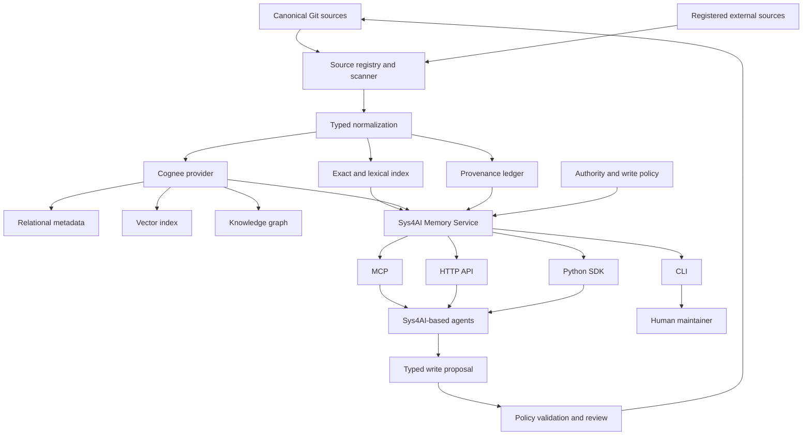
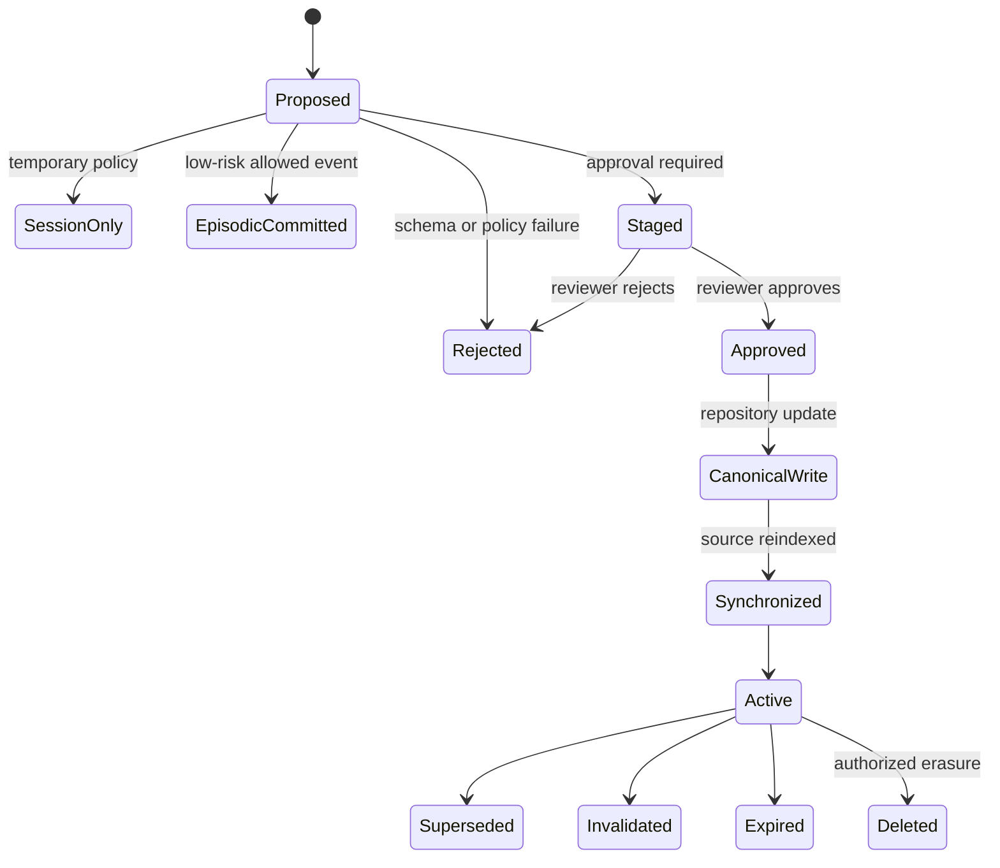

# Product Requirements Document: Sys4AI Memory Service

## Document control

| Field | Value |
|---|---|
| Document ID | `SYS4AI-PRD-MEM-001` |
| Product | Sys4AI |
| Capability | General-purpose project and agent memory |
| Title | Sys4AI Memory Service |
| Status | Proposed for review |
| Version | 1.0 |
| Created | 2026-09-03 |
| Intended repository path | `PRDs/Sys4AI_Memory_Service_PRD.md` |
| Primary owner | Sys4AI maintainers |
| Primary implementation substrate | Cognee through a replaceable provider adapter |
| Canonical source model | Git-native, source-first, rebuildable derived memory |
| Initial operating profile | Local-first, single-host, multi-agent capable |

## Revision history

| Version | Date | Change |
|---|---|---|
| 1.0 | 2026-09-03 | Initial comprehensive PRD adapted from the AEther Flow scientific-memory research into a domain-general Sys4AI memory platform. |

## Status and repository-access note

This PRD was prepared from the supplied `Memory-deep-research.md`, the previously established Sys4AI architecture conventions, and current Cognee documentation and repository information available on 2026-09-03.

The supplied `https://github.com/AngryOwlAI/Sys4AI` repository was not readable through the connected GitHub account or the public GitHub interface during preparation. Therefore:

1. Product-level requirements in this PRD are intended to remain valid regardless of the current repository layout.
2. Proposed paths follow the known Sys4AI conventions: canonical PRDs under `PRDs/`; runtime control records under `Sys4AI/control_records/`; registries, schemas, and validation assets under `Sys4AI/registries/`, `Sys4AI/schemas/`, and `Sys4AI/tests/`; active skills under `.agents/skills/`; and generated artifacts treated as derivatives.
3. Before implementation begins, a repository-fit review must verify path names, package boundaries, command conventions, and any newer architecture decisions. A path mismatch must result in a documented mapping, not a silent restructuring of Sys4AI.

---

## 1. Executive summary

Sys4AI needs a reusable memory foundation that can serve many kinds of agents without being designed around one domain, one model provider, one agent framework, or one database product.

The required product is a **local-first, agent-independent, source-first memory service**. It must give agents persistent recall across sessions while preserving the authority, provenance, exact content, and revision history of the underlying project.

The central architecture decision is:

> Canonical project knowledge remains in version-controlled source files and registered external sources. The memory database is a rebuildable, replaceable, derived index over those sources.

The service must combine five retrieval capabilities:

1. Exact retrieval for identifiers, paths, requirement IDs, task IDs, commands, symbols, and literal text.
2. Lexical retrieval for keyword and phrase matching.
3. Semantic retrieval for conceptually related content.
4. Relational retrieval for dependencies, entities, provenance, and other graph relationships.
5. Temporal retrieval for supersession, validity periods, decisions, events, and prior states.

Cognee is the recommended first machine-memory substrate because its current architecture combines relational metadata, vector retrieval, and a knowledge graph; supports local embedded storage; exposes MCP, HTTP, Python, TypeScript, and Rust-oriented integration paths; and provides a memory-native API based on `remember`, `recall`, `improve`, and `forget`. However, Sys4AI must place Cognee behind a provider interface. Canonical data, public Sys4AI memory contracts, extension profiles, and export formats must not depend on Cognee-specific internal classes.

The base product must be intentionally general. It must provide:

- A small set of generic memory record types.
- A typed write and approval lifecycle.
- Strong separation between governance, deterministic runtime state, project knowledge, external evidence, agent-generated material, and session cache.
- Declarative memory profiles that future agents can extend.
- A stable Memory API and MCP surface.
- Rebuild, export, import, migration, audit, and deletion behavior.
- Trust-aware retrieval that returns evidence and provenance, not anonymous text.
- Security controls against prompt injection, memory poisoning, unauthorized persistence, cross-project leakage, secret ingestion, and destructive forgetting.

The intended result is not a chatbot transcript store. It is a reusable **project memory platform** for building stateful Sys4AI agents.

---

## 2. Product context

### 2.1 What Sys4AI is assumed to be

Sys4AI is a governed framework and executable meta-agent runtime used to create, run, evaluate, and improve different systems and agents. A target agent or target system is a separate governed artifact built from the Sys4AI base.

The memory capability must therefore support two roles at once:

1. **Sys4AI framework memory**: knowledge about Sys4AI itself, including requirements, architecture, skills, conventions, decisions, schemas, source code, and operational history.
2. **Derived-agent memory foundation**: a reusable memory substrate that a research agent, software agent, diagnostic agent, planning agent, tutoring agent, or other future agent can extend with domain-specific types and policies.

### 2.2 Why the AEther Flow architecture cannot be copied unchanged

The supplied AEther Flow research recommends a scientific memory architecture optimized for mathematics and physics. That design correctly emphasizes Git, exact notation, provenance, typed writes, semantic retrieval, graph relationships, and rebuildable databases.

Sys4AI needs the same architectural properties but a different abstraction level:

| AEther Flow specialization | Sys4AI generalization |
|---|---|
| `Theorem`, `Equation`, `Derivation`, `Hypothesis` | Generic typed records plus extension-defined types |
| LaTeX-first scientific source | Registered canonical sources in Markdown, YAML, CSV, TOML, JSON Schema, code, text, and optional domain formats |
| Mathematics-aware exact retrieval | Exact retrieval for any stable identifier, literal expression, file path, command, schema key, code symbol, or domain token |
| Scientific evidence graph | General entity, dependency, provenance, temporal, causal, authority, and workflow relations |
| Research-agent write lifecycle | Policy-controlled write lifecycle reusable by any agent |
| Literature trust boundary | General separation between governance, canonical project sources, connected data, imported evidence, and untrusted content |
| Scientific-memory service | General Sys4AI Memory Service with agent-specific profiles |

### 2.3 Problem statement

Without a durable memory layer, each agent session must reconstruct project context from scratch. This creates predictable failures:

- Important requirements and decisions are omitted from the active context.
- Agents repeat previous work or contradict prior decisions.
- Generated summaries lose exact source details.
- Similarity search returns plausible text without authority or provenance.
- Workflow state becomes mixed with conversational memory.
- Different agents develop incompatible private memories.
- Imported content can influence behavior as if it were governance.
- Database changes can become irreversible or impossible to audit.
- The project becomes coupled to one agent framework or memory vendor.

### 2.4 Product opportunity

A shared memory service lets Sys4AI agents reuse verified project knowledge across sessions and across agent implementations. It also creates a clean extension point: each derived agent can add domain schemas, ingestion adapters, retrieval strategies, write policies, and evaluation cases without replacing the base memory architecture.

---

## 3. Product vision

> Any Sys4AI-based agent can reconnect to a project, recover the relevant verified context, explain where that context came from, and contribute new memory through controlled writes, without making a database more authoritative than the project itself.

A successful implementation will let a future agent answer questions such as:

- What requirement governs this behavior, and where is the canonical requirement?
- Which architecture decision caused this implementation constraint?
- Which files, tasks, or components depend on this schema?
- What was attempted previously, and what was the outcome?
- Which information is approved, proposed, superseded, external, or untrusted?
- Which project memories are available to this agent and this task?
- What new knowledge may this agent write automatically, and what requires approval?
- Can the complete memory database be deleted and rebuilt without losing authoritative knowledge?

---

## 4. Product principles

The following principles are binding product requirements, not optional implementation preferences.

### P-01. Source-first authority

Canonical files and registered source systems are authoritative. Machine memory is derived unless a memory record is explicitly promoted into a canonical source through an approved write workflow.

### P-02. Memory is not deterministic runtime state

The memory service must not replace task indexes, permission envelopes, launch receipts, completion contracts, handoffs, validation results, cancellation records, or other deterministic control records. It may index them for retrieval, but the runtime must re-read and validate the canonical record before acting.

### P-03. Agent independence

The memory service must be callable by different models, agent frameworks, command-line clients, and future runtimes. No agent implementation may own the only copy of durable memory.

### P-04. Provider independence

Cognee is the initial provider, not the Sys4AI public contract. Sys4AI must retain the ability to replace or supplement Cognee without rewriting agents or losing canonical memory.

### P-05. Local-first operation

Core remember, recall, rebuild, export, and administration operations must work on a local machine without a required cloud service. Remote models or managed stores may be optional profiles.

### P-06. Rebuildability

Derived storage must be disposable. Given canonical sources, the source registry, configuration, schemas, and permitted external-source manifests, the service must reconstruct its derived indexes.

### P-07. Typed and policy-controlled writes

Agents must write a declared memory type under a declared scope and policy. Arbitrary transcript dumping into permanent memory is not an acceptable default.

### P-08. Evidence before fluency

Recall must return source anchors, provenance, authority, trust, status, and retrieval details. A fluent answer without inspectable evidence is insufficient for authoritative project work.

### P-09. Trust separation

Instructions and authority can originate only from approved governance and control sources. External documents, web content, issue text, user-generated content, tool output, and retrieved memory are data unless explicitly promoted under policy.

### P-10. Exact content is preserved

Semantic summaries and embeddings must never replace exact source text, stable identifiers, code, configuration, formulas, commands, or structured fields.

### P-11. Non-destructive evolution

Corrections should supersede, qualify, or invalidate prior records with traceable links. The service must not silently overwrite historical knowledge when the history is relevant to project understanding.

### P-12. Least privilege

Each agent receives only the read, propose, improve, approve, delete, and share permissions required by its role and current task.

### P-13. Explicit scope

Every memory operation must identify or resolve a project, dataset or namespace, agent role, and durability scope. Hidden global memory is prohibited.

### P-14. Extension without fork

A derived agent must be able to add memory types and behavior through versioned profiles and adapters. It should not need to fork the Sys4AI memory core.

### P-15. Minimal sufficient validation

Validation must cover contractual risks: authority separation, provenance, isolation, data integrity, rebuildability, deletion, and retrieval correctness. The product must avoid duplicative tests that add maintenance overhead without protecting a requirement.

---

## 5. Goals

### 5.1 Primary goals

| Goal ID | Goal |
|---|---|
| G-01 | Provide persistent project memory across agent sessions. |
| G-02 | Make the memory service reusable by any Sys4AI-derived agent. |
| G-03 | Keep canonical source files and control records authoritative. |
| G-04 | Support exact, lexical, semantic, relational, and temporal retrieval. |
| G-05 | Return provenance and trust information with every durable-memory result. |
| G-06 | Support typed, staged, reviewable, and auditable memory writes. |
| G-07 | Operate locally with no mandatory cloud dependency. |
| G-08 | Rebuild derived indexes from canonical sources. |
| G-09 | Expose stable Python, HTTP, CLI, and MCP-facing contracts. |
| G-10 | Support multi-agent use without concurrent corruption or cross-scope leakage. |
| G-11 | Allow domain-specific memory profiles to extend the base model. |
| G-12 | Preserve portability through Sys4AI-native export plus provider-native export. |

### 5.2 Secondary goals

- Support feedback-driven retrieval improvement without silently changing source truth.
- Support optional session memory and episodic memory.
- Support local and shared-service deployment profiles.
- Provide enough observability to explain ingestion, retrieval, ranking, writes, and deletion.
- Support incremental synchronization using content hashes and source revisions.
- Make repository and source changes visible to memory without full reprocessing when unnecessary.

---

## 6. Non-goals

The first product release is not required to:

1. Replace Git, Sys4AI control records, PRDs, schemas, or source code as the authoritative project store.
2. Store or expose private model chain-of-thought. The system may store concise decision rationale, evidence, tool outcomes, and user-approved summaries.
3. Make every external file format a built-in core dependency.
4. Provide a general autonomous truth-verification engine.
5. Guarantee that an LLM-extracted relation is correct without validation or review.
6. Automatically promote external evidence or agent-generated claims into governance.
7. Provide high-availability distributed infrastructure in the local-first release.
8. Make Cognee internals part of the public Sys4AI agent contract.
9. Replace purpose-built databases used by a derived agent for transactional domain data.
10. Treat an entire conversation transcript as permanent memory by default.
11. Reproduce deterministic commands or policies from embeddings alone.
12. Use the memory store as the sole authorization decision point.

---

## 7. Stakeholders and users

### 7.1 Primary stakeholders

| Stakeholder | Need |
|---|---|
| Sys4AI maintainer | A controllable, inspectable, replaceable memory foundation. |
| System Director or meta-agent | Cross-session project context and evidence-backed recall. |
| Specialized derived agent | Domain-specific memory types without changing the core. |
| Human reviewer | Clear provenance, staged writes, diffs, and approval controls. |
| Implementation agent | Exact requirements, paths, symbols, decisions, and dependency context. |
| Evaluator or auditor | Reproducible ingestion, retrieval traces, permissions, and lifecycle records. |
| Local developer | Simple installation and operation on a workstation. |
| Future team deployment | Dataset isolation, role-based access, concurrency, and migration paths. |

### 7.2 Representative personas

#### Persona A: Sys4AI framework maintainer

Maintains the base system, changes architecture, approves governance, and needs confidence that memory cannot silently become the source of truth.

#### Persona B: Derived-agent developer

Creates a research, diagnostics, coding, tutoring, or planning agent. Needs to define additional memory types and retrieval behavior through a profile.

#### Persona C: Runtime agent

Needs a bounded evidence bundle for the current task, may propose new memory, and must not receive unrelated or unauthorized project data.

#### Persona D: Human reviewer

Reviews proposed decisions, durable observations, summaries, and changes before they become canonical.

---

## 8. Core use cases

### UC-01. Reconnect to a project

An agent starts a new session, identifies the project and role, recalls current governance, active decisions, relevant requirements, architecture, and recent verified outcomes, and receives source anchors for each item.

### UC-02. Retrieve an exact project identifier

An agent asks for `REQ-MEM-042`, a schema key, CLI command, file path, function, class, task ID, or literal expression. The exact channel returns the canonical occurrence even when semantic similarity would rank other material higher.

### UC-03. Retrieve related project knowledge

An agent asks a conceptual question. The service combines lexical, semantic, and graph retrieval, filters by authority and scope, and returns a ranked evidence bundle.

### UC-04. Explain a dependency

An agent asks which requirements, decisions, components, tests, and tasks depend on a specific object. The service traverses typed relations and returns the path between records.

### UC-05. Propose a durable memory

An agent records an observation, result, decision candidate, reusable procedure, or failure pattern. The service validates the type and provenance, applies policy, and either commits it to an allowed canonical target or stages it for review.

### UC-06. Record an episode without making it truth

An agent records that a task was attempted, which tools were used, the outcome, and links to artifacts. The record remains episodic evidence and does not become governance or a verified fact automatically.

### UC-07. Correct prior memory

A human or authorized agent identifies an incorrect or outdated record. The new record supersedes or invalidates the prior record, preserves the history, triggers reindexing, and prevents normal recall from presenting the obsolete record as current.

### UC-08. Rebuild memory

A maintainer deletes derived storage, runs a rebuild command, and receives a receipt proving which source revisions, profiles, models, and adapters produced the new indexes.

### UC-09. Create a domain extension

A derived-agent developer creates a profile that adds types, relations, source adapters, retrieval rules, write policies, and evaluation cases. The base memory API remains unchanged.

### UC-10. Forget or delete data

An authorized user requests removal. The service distinguishes derived-index removal, canonical-source deletion, legal/privacy erasure, session expiration, and historical supersession. It executes only the permitted operation and records a non-sensitive deletion receipt.

### UC-11. Share memory across agents

Several agents access one project memory through a single service. Dataset and permission boundaries prevent cross-project leakage, and write operations are serialized or transactionally controlled.

### UC-12. Export and migrate

A maintainer exports a complete Sys4AI memory package containing manifests, typed records, relations, provenance, and provider metadata. The package can be inspected without Cognee and used to rebuild another provider.

---

## 9. Terminology

| Term | Definition |
|---|---|
| Canonical source | A file or registered system explicitly designated as authoritative for a class of information. |
| Derived memory | Searchable machine representations created from canonical or registered sources. |
| Memory record | A typed, addressable unit of knowledge, evidence, event, or procedure. |
| Source record | Metadata that identifies a canonical or imported source and its revision. |
| Evidence bundle | A recall response containing content plus source anchors, status, trust, and retrieval details. |
| Memory profile | A versioned declarative extension that adds types, relations, adapters, policies, and evaluations. |
| Authority tier | The degree to which a record may govern agent behavior. |
| Trust class | The confidence boundary associated with the origin and review state of content. |
| Scope | The system, project, agent type, agent instance, task, or session to which a record applies. |
| Durable memory | Memory intended to remain available across sessions. |
| Session memory | Short-lived context associated with one session. |
| Episodic memory | A record of an event, attempt, tool use, or outcome. |
| Procedural memory | Instructions or reusable methods describing how work is performed. |
| Semantic memory | Concepts, facts, definitions, and relationships. |
| Exact index | A deterministic index for literal values, identifiers, paths, hashes, and structured keys. |
| Provider | A storage and retrieval implementation used behind the Sys4AI Memory Provider interface. |
| Promotion | An approved operation that writes a staged record into a canonical source. |
| Supersession | A non-destructive relation indicating that a newer record replaces an older record for normal use. |
| Tombstone | A record indicating that an item was deleted or withdrawn without retaining prohibited content. |
| Rebuild receipt | A signed or hashed record of source revisions and configuration used to create derived memory. |

---

## 10. Product boundary: memory, source, state, cache, and logs

Sys4AI must keep the following categories separate.

| Category | Purpose | Authority | Typical format | Memory behavior |
|---|---|---|---|---|
| Governance | Policies, permissions, role definitions, PRDs, architecture decisions | Highest within project | Markdown, YAML, schemas | Indexed in isolated authority namespace; never created from external retrieval |
| Deterministic runtime state | Task status, permission envelopes, receipts, handoffs, validation results | Authoritative for execution | YAML, CSV, JSON Schema validated files | Indexed for discovery; reread canonically before action |
| Canonical project knowledge | Documentation, code, configurations, accepted decisions, procedures | Authoritative within declared role | Markdown, code, TOML, YAML, CSV | Fully indexed with provenance |
| Registered external evidence | Repositories, documents, web captures, issue systems, datasets | Evidence only by default | Source-dependent | Isolated trust class and namespace |
| Agent-generated durable material | Proposed observations, summaries, results, patterns | Non-authoritative until approved | Typed YAML/Markdown/JSONL | Staged and policy controlled |
| Episodic records | Attempts, actions, outcomes, failures | Evidence of events | JSONL/YAML | Time-aware, retained by policy |
| Session cache | Current conversation and temporary context | Not durable authority | Provider cache | Expires automatically |
| Scratch data | Intermediate calculations and temporary extracts | None | Temporary files | Excluded from durable ingestion by default |
| Audit log | Who did what, when, and under which policy | Authoritative operational evidence | Append-only JSONL or database plus export | Searchable but not executable instruction |
| Derived index | Embeddings, graph nodes, chunks, ranking signals | Never canonical | Cognee stores, SQLite FTS, caches | Disposable and rebuildable |

### Binding boundary rule

A memory result may inform an agent, but an action that depends on permissions, task completion, schema validity, or current control state must validate the corresponding canonical record at execution time.

---

## 11. Architecture decision

### 11.1 Selected architecture

```text
                         CANONICAL PROJECT SOURCES
                                  Git
                                   |
             +---------------------+----------------------+
             |                     |                      |
       Governance and         Runtime control        Project knowledge
       requirements           records                and code
       Markdown/schema        YAML/CSV/schema        docs/config/code
             |                     |                      |
             +---------------------+----------------------+
                                   |
                         Source registry and scanner
                                   |
                         Typed normalization layer
                                   |
              +--------------------+--------------------+
              |                    |                    |
        Exact/lexical          Cognee provider      Provenance ledger
        deterministic         vector + graph +      source revisions,
        retrieval             relational stores     hashes, receipts
              |                    |                    |
              +--------------------+--------------------+
                                   |
                         Sys4AI Memory Service
                  policy, scope, ranking, evidence assembly
                                   |
                   +---------------+---------------+
                   |               |               |
                  MCP             HTTP            Python/CLI
                   |               |               |
                   +---------------+---------------+
                                   |
                       Any Sys4AI-based agent
                                   |
                       typed write proposals
                                   |
                    staged review or approved write
                                   |
                                  Git
```

### 11.2 Mermaid system context



### 11.3 Why Cognee is selected initially

As of 2026-09-03, Cognee provides the following relevant capabilities:

- A memory-native API based on `remember`, `recall`, `improve`, and `forget`.
- Relational, vector, and graph-backed memory.
- Local embedded defaults using SQLite, LanceDB, and Ladybug/Kuzu-compatible graph storage in standalone operation.
- MCP standalone and API modes.
- Dataset-scoped permissions and multi-user isolation when supported backends and access control are enabled.
- Pydantic-based DataPoints with IDs, versioning, timestamps, indexing hints, and graph relationships.
- COGX import and export for provider-level portability.
- Python, TypeScript, and Rust-facing integration options.

The current public Cognee release observed during preparation was `v1.5.3`, published 2026-08-23. The implementation must pin and test an approved version rather than following an unbounded latest version.

### 11.4 Why Cognee is not the public architecture

Sys4AI must add controls that are outside the responsibility of a generic memory provider:

- Canonical-source authority.
- Deterministic exact lookup.
- Governance isolation and precedence.
- Sys4AI scopes and permission envelopes.
- Typed write proposals and promotion to Git.
- Rebuild manifests and source-revision receipts.
- Provider-neutral export.
- Domain extension profiles.
- Runtime-state boundary checks.
- Security rules for untrusted retrieved content.

---

## 12. Recommended repository integration

The exact paths must be verified against the accessible repository before implementation. The following structure is the proposed target because it preserves existing Sys4AI conventions.

```text
PRDs/
└── Sys4AI_Memory_Service_PRD.md

Sys4AI/
├── memory/
│   ├── README.md
│   ├── api/
│   ├── core/
│   ├── providers/
│   │   ├── base.py
│   │   └── cognee/
│   ├── exact_index/
│   ├── ingestion/
│   ├── retrieval/
│   ├── policies/
│   ├── profiles/
│   │   └── base/
│   ├── migrations/
│   └── cli/
│
├── registries/
│   ├── memory_source_registry.csv
│   ├── memory_profile_registry.csv
│   └── memory_relation_registry.csv
│
├── schemas/
│   └── memory/
│       ├── memory_record.schema.json
│       ├── source_record.schema.json
│       ├── relation_record.schema.json
│       ├── write_proposal.schema.json
│       ├── retrieval_result.schema.json
│       ├── memory_profile.schema.json
│       └── rebuild_receipt.schema.json
│
├── control_records/
│   └── memory/
│       ├── proposals/
│       ├── approvals/
│       ├── deletion_receipts/
│       ├── rebuild_receipts/
│       ├── migrations/
│       └── incidents/
│
└── tests/
    └── memory/
        ├── fixtures/
        ├── golden_queries/
        └── security_cases/

config/
└── memory.toml

.agents/
└── skills/
    └── memory-service/

.sys4ai/
└── memory/                    # generated, local, gitignored
    ├── cognee/
    ├── exact_index/
    ├── cache/
    ├── staging/
    └── exports/
```

### 12.1 Canonical versus generated paths

| Path class | Git policy |
|---|---|
| `PRDs/`, source code, schemas, registries, profiles, policies | Tracked and reviewed |
| `Sys4AI/control_records/memory/` | Tracked when records are intended as durable project evidence |
| `.sys4ai/memory/` | Gitignored and reconstructible |
| Model caches and downloaded weights | Gitignored |
| Provider database files | Gitignored |
| Temporary extraction output | Gitignored |
| Export packages | Gitignored by default; attach to releases or store explicitly when needed |

---

## 13. Source and format policy

### 13.1 Default source roles

| Format or source | Default role | Authority behavior |
|---|---|---|
| Markdown | PRDs, governance, architecture, procedures, documentation | Authority depends on registered path and document status |
| YAML | Agent jobs, handoffs, receipts, manifests, bounded runtime state | Authoritative only when schema-valid and in a registered control path |
| CSV | Registries, ledgers, relationships, provenance, indexes | Authoritative only under registered schema and ownership |
| TOML | Tool, runtime, and memory configuration | Authoritative configuration source |
| JSON Schema | Validation contracts | Authoritative schema source |
| Source code | Executable implementation and code structure | Canonical implementation evidence |
| JSON/JSONL | Structured exchange and append-only event records | Role set by registry |
| Text | Notes or imported content | Non-authoritative unless explicitly registered |
| PDF/HTML | Usually generated output or imported evidence | Non-authoritative by default |
| Git history | Revision, authorship, review, rollback, and provenance evidence | Authoritative history for tracked sources |
| GitHub issues/PRs | Discussion and evidence | Not governance unless a decision is promoted to a canonical record |
| Web pages/connectors | External evidence | Untrusted content by default |
| Cognee graph/vector records | Derived retrieval representation | Never canonical |

### 13.2 Source registry

No source may enter durable project memory without a source-registry rule or an explicit one-time registration operation that creates such a rule.

Proposed `memory_source_registry.csv` columns:

```text
source_id
project_id
path_or_uri
path_pattern
source_kind
format
canonicality
content_role
authority_tier
trust_class
sensitivity
namespace
profile_id
ingestion_adapter
chunking_profile
schema_ref
refresh_mode
retention_policy
owner
write_policy
include_flag
notes
```

### 13.3 Source registration requirements

- Include and exclude patterns must be explicit.
- Secret files, provider databases, caches, build artifacts, and temporary directories must be excluded by default.
- A source registration must declare whether the source is authoritative, evidential, generated, episodic, or scratch.
- Generated HTML, PDF, wikis, summaries, and indexes must not outrank their canonical inputs.
- A source must have a stable `source_id` independent of its current file name when practical.
- Repository sources must record a Git commit, blob hash, or working-tree state.
- External sources must record origin URI, retrieval time, content hash, and licensing or retention metadata when available.

---

## 14. Memory scopes

Every durable memory record must declare one scope and may declare parent scopes.

| Scope | Purpose | Example |
|---|---|---|
| `system` | Applies to the Sys4AI framework as a whole | Core memory contract |
| `workspace` | Applies to one installation or organization | Local deployment convention |
| `project` | Applies to one target repository or project | Sys4AI repository memory |
| `agent_type` | Applies to a class of agents | Research-agent methodology |
| `agent_instance` | Applies to one configured agent | Tool preference for one agent instance |
| `task` | Applies to one bounded task or goal | Findings for task `T-014` |
| `session` | Temporary session context | Current conversation facts |
| `user` | Applies to one authorized user | Explicit user preference, subject to privacy policy |

### 14.1 Scope resolution rules

1. A query must supply a project scope or be executed under a service context that resolves one.
2. System governance may be inherited by project scopes.
3. Project memory must not leak into another project without an explicit shared dataset or grant.
4. Task and session memory may fall back to project memory for recall.
5. Lower scopes may refine preferences and context but may not override higher-authority governance.
6. Agent-instance memory must not become shared project truth automatically.
7. Cross-project search must require an explicit multi-project query and authorization.

---

## 15. Authority, trust, and epistemic status

### 15.1 Authority tiers

| Tier | Name | Examples | May instruct agent behavior? |
|---|---|---|---|
| A0 | System policy | Platform safety and host restrictions | Yes, highest |
| A1 | Approved Sys4AI governance | Approved PRDs, policies, roles, schemas | Yes |
| A2 | Approved project control and decisions | Valid control records, accepted decision records | Yes within scope |
| A3 | Canonical project knowledge | Code, accepted procedures, approved docs | Inform and constrain within declared role |
| A4 | Registered external evidence | Documentation, papers, issues, web captures | No, evidence only |
| A5 | Agent-generated durable material | Summaries, observations, candidates | No until promoted |
| A6 | Session and scratch content | Conversation context, temporary extracts | No durable authority |
| A7 | Untrusted content | Unknown imports, retrieved pages, embedded instructions | Never |

### 15.2 Trust classes

Recommended values:

```text
system-controlled
human-approved
schema-validated
project-authored
externally-authenticated
external-unverified
agent-generated
model-extracted
user-supplied
untrusted
```

Trust and authority are separate. A technically authenticated external document can still have no authority to modify agent behavior.

### 15.3 Record status

Recommended lifecycle values:

```text
proposed
staged
approved
active
superseded
rejected
invalidated
expired
withdrawn
deleted
```

### 15.4 Epistemic status

Recommended values:

```text
source_statement
observation
claim
fact_candidate
verified_fact
hypothesis
inference
decision
procedure
preference
constraint
result
counterexample
unknown
```

A record must not be labeled `verified_fact` merely because an LLM extracted or summarized it.

---

## 16. Base memory type system

The base type system must be small enough to remain general but expressive enough to support governance, project knowledge, events, and extensions.

### 16.1 Required core types

| Type | Purpose |
|---|---|
| `SourceArtifact` | A canonical or registered file, URI, object, or repository unit. |
| `SourceFragment` | A stable addressable section, block, row, code symbol, or chunk within a source. |
| `Entity` | A named project concept, component, person, system, tool, file, schema, or domain object. |
| `Statement` | A typed proposition, claim, constraint, fact candidate, or verified fact. |
| `Requirement` | A requirement indexed from an authoritative PRD or requirements source. |
| `Decision` | An accepted, proposed, superseded, or rejected decision. |
| `Procedure` | A reusable method, instruction set, runbook, or skill-derived process. |
| `Event` | A time-bounded occurrence such as a run, change, attempt, incident, or review. |
| `Observation` | A recorded finding from a user, tool, agent, or process. |
| `Outcome` | A result of a task, experiment, validation, or operation. |
| `Feedback` | A correction, preference signal, rating, or retrieval-use signal. |
| `Relation` | A typed edge between memory records. |
| `Tombstone` | A deletion or withdrawal marker that does not preserve prohibited content. |
| `ExtensionRecord` | A record validated by an installed memory profile. |

### 16.2 Required core relations

```text
CONTAINS
DEFINES
DESCRIBES
IMPLEMENTS
VALIDATES
DEPENDS_ON
BLOCKS
ENABLES
DERIVED_FROM
GENERATED_FROM
CITES
SUPPORTS
CONTRADICTS
SUPERSEDES
INVALIDATES
APPLIES_TO
OWNED_BY
CREATED_BY
REVIEWED_BY
OBSERVED_DURING
RESULTED_IN
SIMILAR_TO
RELATED_TO
HAS_SOURCE
HAS_EVIDENCE
HAS_STATUS
USES
PRODUCES
```

### 16.3 Extension rule

A memory profile may add types and relations but must not change the meaning of a core type or relation. A breaking semantic change requires a new profile major version and migration.

### 16.4 Example extension mappings

| Derived agent | Additional types |
|---|---|
| Research agent | `Paper`, `Hypothesis`, `Experiment`, `Equation`, `Theorem`, `Derivation`, `Dataset` |
| Software agent | `Module`, `Class`, `Function`, `API`, `Bug`, `Patch`, `TestCase`, `BuildFailure` |
| MFP diagnostic agent | `MachineModel`, `Symptom`, `FaultCode`, `Cause`, `TestStep`, `Part`, `RepairOutcome` |
| Tutor agent | `LearningObjective`, `Concept`, `Misconception`, `Exercise`, `Attempt`, `MasteryEstimate` |
| Planning agent | `Goal`, `Milestone`, `Resource`, `Risk`, `Dependency`, `ScheduleConstraint` |

---

## 17. Functional requirements

Requirement priority uses:

- `MUST`: required for the first production-capable release.
- `SHOULD`: required unless a documented decision defers it.
- `MAY`: optional extension.

### 17.1 Service boundary and provider abstraction

| ID | Priority | Requirement |
|---|---|---|
| MEM-FR-001 | MUST | The memory capability shall run as a service or service-equivalent process independent of any specific agent. |
| MEM-FR-002 | MUST | Agents shall access memory through stable Sys4AI contracts rather than direct Cognee database access. |
| MEM-FR-003 | MUST | A `MemoryProvider` interface shall isolate provider-specific remember, recall, improve, forget, health, export, and migration behavior. |
| MEM-FR-004 | MUST | The first provider implementation shall integrate Cognee. |
| MEM-FR-005 | MUST | Provider selection and configuration shall be externalized from agent code. |
| MEM-FR-006 | MUST | A provider failure shall not remove or corrupt canonical source files. |
| MEM-FR-007 | SHOULD | The service shall support more than one provider or retrieval channel in a composed query. |
| MEM-FR-008 | MUST | The exact index shall remain available independently of semantic-completion generation. |
| MEM-FR-009 | MUST | The public contract shall use Sys4AI record and error schemas, not raw provider response shapes. |
| MEM-FR-010 | MUST | The selected Cognee version and dependency range shall be pinned through the project dependency mechanism. |

### 17.2 Project initialization and configuration

| ID | Priority | Requirement |
|---|---|---|
| MEM-FR-011 | MUST | The service shall initialize memory for a declared `project_id` and repository root. |
| MEM-FR-012 | MUST | Initialization shall create or validate local derived-storage paths without modifying canonical project files unexpectedly. |
| MEM-FR-013 | MUST | Configuration shall support local model, remote model, local embedding, remote embedding, and provider-specific profiles without changing the public API. |
| MEM-FR-014 | MUST | Configuration shall identify excluded paths, sensitivity rules, source registries, active profiles, and retention policies. |
| MEM-FR-015 | MUST | Configuration changes that affect indexing shall generate a new configuration fingerprint. |
| MEM-FR-016 | SHOULD | The CLI shall include an initialization command that previews planned files and exclusions before writing. |
| MEM-FR-017 | MUST | Initialization shall not ingest `.env`, secrets, credentials, private keys, provider databases, or ignored build/cache paths by default. |
| MEM-FR-018 | SHOULD | The service shall detect common unsafe include patterns and refuse initialization unless explicitly overridden. |

### 17.3 Source registration and discovery

| ID | Priority | Requirement |
|---|---|---|
| MEM-FR-019 | MUST | Every durable source shall be represented by a `SourceRecord`. |
| MEM-FR-020 | MUST | Source discovery shall use the canonical source registry and explicit one-time registrations. |
| MEM-FR-021 | MUST | Each source record shall declare role, canonicality, authority, trust, sensitivity, scope, adapter, owner, and retention. |
| MEM-FR-022 | MUST | Repository sources shall capture path, content hash, Git revision or working-tree state, and locator metadata. |
| MEM-FR-023 | MUST | External sources shall capture origin, retrieval time, content hash, and available licensing or access metadata. |
| MEM-FR-024 | MUST | Generated sources shall link to the canonical inputs that produced them. |
| MEM-FR-025 | MUST | A generated source shall not outrank its canonical input during retrieval. |
| MEM-FR-026 | MUST | Source inclusion and exclusion shall be explainable through a dry-run report. |
| MEM-FR-027 | SHOULD | Source discovery shall support Git-aware incremental scanning. |
| MEM-FR-028 | MUST | Deleted, renamed, and moved sources shall be detected and reconciled using IDs and hashes where possible. |

### 17.4 Ingestion and normalization

| ID | Priority | Requirement |
|---|---|---|
| MEM-FR-029 | MUST | Ingestion shall transform each registered source into provider-neutral typed records before or alongside provider ingestion. |
| MEM-FR-030 | MUST | Ingestion shall preserve exact original content or an exact retrievable source locator. |
| MEM-FR-031 | MUST | Ingestion shall support Markdown, YAML, CSV, TOML, JSON, JSONL, JSON Schema, plain text, and common source-code formats in the base profile. |
| MEM-FR-032 | SHOULD | PDF, HTML, office documents, images, audio, and domain formats shall be added through optional adapters. |
| MEM-FR-033 | MUST | Format-aware adapters shall identify natural units such as headings, requirements, table rows, schema definitions, code symbols, and configuration sections. |
| MEM-FR-034 | MUST | The service shall not rely on arbitrary fixed-size chunks as the only representation. |
| MEM-FR-035 | MUST | Each normalized record shall include source ID, locator, content hash, extractor version, profile version, and processing time. |
| MEM-FR-036 | MUST | LLM-extracted fields shall be marked as model-extracted and shall record model and prompt/configuration fingerprints. |
| MEM-FR-037 | MUST | Deterministically parsed fields shall be distinguishable from model-extracted fields. |
| MEM-FR-038 | MUST | Re-ingestion of unchanged content shall be idempotent. |
| MEM-FR-039 | MUST | Changed content shall invalidate or supersede derived records tied to the prior source revision. |
| MEM-FR-040 | SHOULD | Interrupted ingestion shall be resumable from checkpoints when the selected provider supports it. |
| MEM-FR-041 | MUST | Ingestion errors shall identify source, adapter, stage, error category, and recovery action. |
| MEM-FR-042 | MUST | A failed source shall not prevent already valid sources from remaining queryable. |

### 17.5 Exact and lexical indexing

| ID | Priority | Requirement |
|---|---|---|
| MEM-FR-043 | MUST | The service shall maintain a deterministic index for exact identifiers, paths, labels, hashes, schema keys, commands, code symbols, and literal phrases. |
| MEM-FR-044 | MUST | Exact retrieval shall preserve case-sensitive and case-insensitive query modes. |
| MEM-FR-045 | MUST | Exact results shall include file or source locators and source revision. |
| MEM-FR-046 | MUST | Lexical retrieval shall support token, phrase, prefix, and field-scoped queries. |
| MEM-FR-047 | SHOULD | The implementation may use SQLite FTS5, a compatible embedded lexical engine, or canonical-source search, provided behavior satisfies the contract. |
| MEM-FR-048 | MUST | The exact index shall be rebuildable from canonical sources. |
| MEM-FR-049 | MUST | Exact matches shall receive an explicit ranking signal rather than being diluted into embedding similarity. |
| MEM-FR-050 | SHOULD | A query may request exact-only mode without invoking an LLM. |

### 17.6 Semantic, graph, and temporal memory

| ID | Priority | Requirement |
|---|---|---|
| MEM-FR-051 | MUST | The Cognee provider shall create semantic and relational representations for eligible records. |
| MEM-FR-052 | MUST | The provider integration shall map Sys4AI stable IDs into provider records. |
| MEM-FR-053 | MUST | Only fields declared embeddable by the base type or active profile shall be embedded. |
| MEM-FR-054 | MUST | Non-embedded exact fields shall remain retrievable as structured properties. |
| MEM-FR-055 | MUST | Graph relations shall retain relation type, source, confidence or validation state, and temporal fields when applicable. |
| MEM-FR-056 | SHOULD | The service shall support validity intervals such as `valid_from` and `valid_to`. |
| MEM-FR-057 | MUST | Superseded and invalidated records shall be excluded from normal current-state recall unless requested. |
| MEM-FR-058 | SHOULD | Historical queries shall be able to retrieve prior valid states. |
| MEM-FR-059 | MUST | Provider-generated graph relations shall not be treated as verified merely because they exist in the graph. |
| MEM-FR-060 | SHOULD | Authorized advanced clients may request graph paths or structured graph queries under policy. |

### 17.7 Recall and evidence assembly

| ID | Priority | Requirement |
|---|---|---|
| MEM-FR-061 | MUST | `recall` shall be the primary agent-facing read operation. |
| MEM-FR-062 | MUST | Recall shall accept query text, project scope, requester identity, requested namespaces, status filters, trust filters, time constraints, result budget, and retrieval mode. |
| MEM-FR-063 | MUST | Recall shall combine exact, lexical, semantic, graph, and temporal candidates when hybrid mode is selected. |
| MEM-FR-064 | MUST | Recall shall enforce permissions before retrieval and before evidence assembly. |
| MEM-FR-065 | MUST | Recall shall apply authority and trust filters before returning context to an agent. |
| MEM-FR-066 | MUST | Recall shall return an evidence bundle with stable record IDs, source anchors, source revisions, status, authority, trust, and channel scores. |
| MEM-FR-067 | MUST | Recall shall distinguish direct source text, deterministic extraction, model extraction, and generated summary. |
| MEM-FR-068 | MUST | Recall shall deduplicate overlapping chunks and records. |
| MEM-FR-069 | MUST | Recall shall prefer canonical and current records when relevance is otherwise similar. |
| MEM-FR-070 | MUST | Recall shall expose why a result was selected, including retrieval channels and relevant filters. |
| MEM-FR-071 | SHOULD | Recall shall support retrieval-only mode that performs no answer synthesis. |
| MEM-FR-072 | SHOULD | Recall shall support provider-assisted answer synthesis only when the caller requests it. |
| MEM-FR-073 | MUST | Synthesized responses shall retain citations or source anchors for each material claim when possible. |
| MEM-FR-074 | MUST | Governance retrieval shall occur in an isolated namespace and shall not be mixed indiscriminately with external content. |
| MEM-FR-075 | MUST | Retrieval of a control record shall not substitute for canonical validation at execution time. |
| MEM-FR-076 | SHOULD | The service shall support context budgets by records, characters, tokens, relation depth, and source diversity. |
| MEM-FR-077 | SHOULD | The service shall support minimum diversity across sources to reduce duplicate evidence from one document. |
| MEM-FR-078 | MUST | When evidence is insufficient, recall shall report insufficiency rather than fabricate a record. |

### 17.8 Session and episodic memory

| ID | Priority | Requirement |
|---|---|---|
| MEM-FR-079 | SHOULD | The service shall support session-scoped memory with configurable expiration. |
| MEM-FR-080 | MUST | Session memory shall be distinguishable from permanent project memory. |
| MEM-FR-081 | MUST | Session content shall not be promoted automatically to durable authority. |
| MEM-FR-082 | SHOULD | Episodic records shall capture task, actor, timestamps, tools, inputs by reference, outputs by reference, outcome, and related records. |
| MEM-FR-083 | MUST | Episodic memory shall store concise rationale and evidence rather than private chain-of-thought. |
| MEM-FR-084 | SHOULD | Repeated failed approaches may be consolidated into a reusable failure pattern through an approved improve workflow. |
| MEM-FR-085 | MUST | Session deletion shall not delete canonical project memory. |

### 17.9 Typed writes and promotion

| ID | Priority | Requirement |
|---|---|---|
| MEM-FR-086 | MUST | An agent durable write shall identify type, scope, source or evidence, status, trust, sensitivity, and requested canonical target. |
| MEM-FR-087 | MUST | The service shall reject untyped arbitrary permanent writes unless an explicit compatibility policy allows them. |
| MEM-FR-088 | MUST | Writes shall pass schema validation and authorization before persistence. |
| MEM-FR-089 | MUST | Writes shall include an idempotency key or stable proposal ID. |
| MEM-FR-090 | MUST | Governance and permission changes shall require human approval unless a higher system policy explicitly authorizes automation. |
| MEM-FR-091 | MUST | External content shall never be promoted directly into governance based only on retrieved text. |
| MEM-FR-092 | MUST | The write policy shall choose among reject, session-only, episodic commit, derived commit, stage for review, or canonical promotion. |
| MEM-FR-093 | MUST | A staged proposal shall be human-readable and include the target file, proposed patch or record, evidence, and policy decision. |
| MEM-FR-094 | MUST | Canonical promotion shall use normal repository writes and review conventions. |
| MEM-FR-095 | MUST | Successful canonical promotion shall trigger source synchronization rather than a separate contradictory memory write. |
| MEM-FR-096 | MUST | Rejected proposals shall retain only the metadata required by retention policy and shall not appear as active knowledge. |
| MEM-FR-097 | SHOULD | Low-risk agent observations may be auto-committed to an episodic log when policy permits. |
| MEM-FR-098 | MUST | An agent shall not write to a scope broader than its permission envelope. |
| MEM-FR-099 | MUST | Write operations shall be atomic from the perspective of the public API. |
| MEM-FR-100 | MUST | Concurrent writes shall use locking, transactions, or serialized service queues to prevent corruption. |

### 17.10 Improve and consolidation

| ID | Priority | Requirement |
|---|---|---|
| MEM-FR-101 | MUST | `improve` shall operate on derived memory quality and feedback; it shall not silently edit canonical sources. |
| MEM-FR-102 | MUST | Improvement inputs shall identify their origin, such as correction, reuse, retrieval selection, explicit rating, or validation result. |
| MEM-FR-103 | MUST | Improvement shall be reproducible or at least auditable through an improvement receipt. |
| MEM-FR-104 | MUST | Provider-side reweighting shall not change a record's authority, trust, or approval status. |
| MEM-FR-105 | MUST | Consolidation shall preserve links to original evidence. |
| MEM-FR-106 | MUST | Conflicting records shall not be merged into one false consensus. |
| MEM-FR-107 | SHOULD | The service may create derived summaries or patterns when source coverage and provenance are retained. |
| MEM-FR-108 | MUST | Any generated consolidated record shall be labeled as generated and carry the generator configuration fingerprint. |
| MEM-FR-109 | SHOULD | Improvement may identify stale, duplicate, weakly supported, or frequently useful records for review. |
| MEM-FR-110 | MUST | An improve operation shall be scoped to authorized datasets and profiles. |

### 17.11 Forget, deletion, expiration, and supersession

| ID | Priority | Requirement |
|---|---|---|
| MEM-FR-111 | MUST | The service shall distinguish `expire`, `withdraw`, `supersede`, `delete-derived`, `delete-source`, and `privacy-erase`. |
| MEM-FR-112 | MUST | Provider `forget` shall not be treated as canonical deletion unless the source lifecycle is also resolved. |
| MEM-FR-113 | MUST | Deleting derived memory while retaining canonical source shall permit later rebuild. |
| MEM-FR-114 | MUST | Deleting a canonical source shall require authorization and normal repository controls. |
| MEM-FR-115 | MUST | Privacy erasure shall remove prohibited content from canonical and derived locations within the declared scope. |
| MEM-FR-116 | MUST | Deletion receipts shall avoid reproducing erased sensitive content. |
| MEM-FR-117 | MUST | Supersession shall preserve historical linkage unless privacy or legal policy requires erasure. |
| MEM-FR-118 | MUST | Expired session memory shall be purged according to retention policy. |
| MEM-FR-119 | MUST | Forget operations shall be idempotent. |
| MEM-FR-120 | MUST | Destructive operations shall support dry-run and affected-record reporting. |

### 17.12 Rebuild and synchronization

| ID | Priority | Requirement |
|---|---|---|
| MEM-FR-121 | MUST | The service shall provide full rebuild and incremental sync operations. |
| MEM-FR-122 | MUST | A rebuild shall be possible after deleting all provider databases and exact indexes. |
| MEM-FR-123 | MUST | Rebuild shall use the source registry, profile registry, schemas, canonical sources, and external manifests. |
| MEM-FR-124 | MUST | A rebuild receipt shall record source revisions, content hashes, configuration fingerprint, profile versions, adapter versions, provider version, model identifiers, start/end time, warnings, and outcome. |
| MEM-FR-125 | MUST | Rebuild shall not write new canonical knowledge. |
| MEM-FR-126 | MUST | Incremental sync shall process additions, changes, moves, and deletions. |
| MEM-FR-127 | SHOULD | Rebuild shall support a deterministic mode that disables non-deterministic extraction or records sufficient configuration to compare outputs. |
| MEM-FR-128 | MUST | Failed rebuilds shall leave the prior valid index available or restore it. |
| MEM-FR-129 | SHOULD | The service shall build into a temporary generation and atomically activate it after validation. |
| MEM-FR-130 | MUST | A health check shall report source/index drift. |

### 17.13 Export, import, backup, and migration

| ID | Priority | Requirement |
|---|---|---|
| MEM-FR-131 | MUST | The service shall export a provider-neutral Sys4AI Memory Package. |
| MEM-FR-132 | MUST | The package shall include a manifest, source metadata, typed records, relations, provenance, statuses, profile versions, and checksums. |
| MEM-FR-133 | MUST | The package shall be inspectable with standard tools without running Cognee. |
| MEM-FR-134 | MUST | Sensitive content shall be filtered or encrypted according to export policy. |
| MEM-FR-135 | SHOULD | The Cognee adapter shall also support COGX export and import where compatible. |
| MEM-FR-136 | MUST | Import shall validate schema, checksums, project scope, profile compatibility, and trust classification before activation. |
| MEM-FR-137 | MUST | Imported records shall retain original origin and import provenance. |
| MEM-FR-138 | MUST | An import shall not overwrite a canonical source silently. |
| MEM-FR-139 | SHOULD | Migration tools shall support versioned transformations with dry-run reports. |
| MEM-FR-140 | MUST | Backup documentation shall state which assets are canonical, derived, optional, or sensitive. |

### 17.14 Profiles and extensions

| ID | Priority | Requirement |
|---|---|---|
| MEM-FR-141 | MUST | The base memory capability shall load a versioned `base` profile. |
| MEM-FR-142 | MUST | A derived agent shall be able to declare one or more extension profiles. |
| MEM-FR-143 | MUST | A profile may add record types, relations, adapters, index fields, query strategies, write policies, retention policies, and evaluation cases. |
| MEM-FR-144 | MUST | A profile shall declare compatibility with the base profile and required provider capabilities. |
| MEM-FR-145 | MUST | Profile loading shall be deterministic and ordered. |
| MEM-FR-146 | MUST | Conflicting type or relation definitions shall fail validation rather than resolve silently. |
| MEM-FR-147 | MUST | Profile changes that alter stored representation shall require a migration or rebuild. |
| MEM-FR-148 | SHOULD | Profiles may provide domain-specific context assembly and reranking rules. |
| MEM-FR-149 | MUST | Profile-specific instructions shall not exceed the authority granted to the profile source. |
| MEM-FR-150 | MUST | An extension shall not require changes to the public agent memory API for ordinary use. |

### 17.15 Interfaces: Python, HTTP, CLI, and MCP

| ID | Priority | Requirement |
|---|---|---|
| MEM-FR-151 | MUST | The service shall expose a Python client used by Sys4AI runtime code. |
| MEM-FR-152 | MUST | The service shall expose an HTTP API for process-independent clients. |
| MEM-FR-153 | MUST | The service shall expose an MCP interface for compatible agents. |
| MEM-FR-154 | MUST | The service shall provide a CLI for initialization, sync, recall, inspection, rebuild, export, import, and health checks. |
| MEM-FR-155 | MUST | All interfaces shall map to the same authorization, validation, and audit behavior. |
| MEM-FR-156 | MUST | Interface responses shall include a request or trace ID. |
| MEM-FR-157 | MUST | Long-running operations shall expose status and resumable or retry-safe behavior. |
| MEM-FR-158 | MUST | MCP tools shall have narrow descriptions and explicit read/write/destructive annotations. |
| MEM-FR-159 | MUST | Destructive MCP operations shall not be enabled by default for general agents. |
| MEM-FR-160 | SHOULD | A read-only deployment mode shall disable all mutation tools. |

### 17.16 Permissions and isolation

| ID | Priority | Requirement |
|---|---|---|
| MEM-FR-161 | MUST | Permissions shall be enforced at the project or dataset boundary before each operation. |
| MEM-FR-162 | MUST | Permission types shall include at least read, propose, write-derived, approve, delete, share, rebuild, and administer. |
| MEM-FR-163 | MUST | The Cognee dataset mapping shall preserve project isolation. |
| MEM-FR-164 | MUST | Shared or multi-user deployments shall enable supported backend access control and authentication. |
| MEM-FR-165 | MUST | Single-user development mode shall be clearly labeled and shall not be presented as a secure shared configuration. |
| MEM-FR-166 | MUST | Cross-project recall shall require explicit authorization and query scope. |
| MEM-FR-167 | MUST | An agent's permission envelope shall be resolved from canonical authorization sources, not from remembered prose. |
| MEM-FR-168 | MUST | Service credentials and model keys shall never be stored in memory records. |
| MEM-FR-169 | SHOULD | Sensitive namespaces may require separate encryption keys or storage profiles. |
| MEM-FR-170 | MUST | Audit records shall capture the effective principal and policy decision. |

### 17.17 Audit and observability

| ID | Priority | Requirement |
|---|---|---|
| MEM-FR-171 | MUST | The service shall audit initialization, source registration, ingestion, recall, write proposals, approvals, improve, forget, rebuild, import, export, and administrative changes. |
| MEM-FR-172 | MUST | Audit events shall include timestamp, actor, project, operation, target, decision, outcome, trace ID, and relevant version fingerprints. |
| MEM-FR-173 | MUST | Logs shall redact secrets and configured sensitive fields. |
| MEM-FR-174 | MUST | Recall traces shall expose selected retrieval channels, candidate counts, filters, ranking stages, and returned sources. |
| MEM-FR-175 | SHOULD | The service shall expose metrics for ingestion lag, recall latency, recall quality, index drift, write approval rate, failures, and storage size. |
| MEM-FR-176 | MUST | Health checks shall cover provider connectivity, exact index, source registry, schema compatibility, storage access, and drift. |
| MEM-FR-177 | SHOULD | OpenTelemetry-compatible tracing may be supported. |
| MEM-FR-178 | MUST | Operational telemetry shall be locally controllable and shall not transmit project content without explicit configuration. |

---

## 18. Public operation model

Sys4AI may internally map to Cognee's `remember`, `recall`, `improve`, and `forget`, but the product requires a richer controlled surface.

### 18.1 Required operations

| Operation | Purpose | Mutating |
|---|---|---:|
| `memory.health` | Report service, provider, index, registry, and drift status | No |
| `memory.sources.list` | List visible registered sources | No |
| `memory.sources.explain` | Explain why a path or URI is included or excluded | No |
| `memory.sync` | Incrementally synchronize registered sources | Yes, derived only |
| `memory.recall` | Retrieve an evidence bundle | No |
| `memory.get` | Retrieve one record by stable ID | No |
| `memory.graph` | Retrieve authorized relations or paths | No |
| `memory.propose` | Submit a typed write proposal | Yes, staged |
| `memory.approve` | Approve or reject a staged proposal | Yes, privileged |
| `memory.supersede` | Link a replacement to an earlier record | Yes |
| `memory.improve` | Apply feedback or provider-side improvement | Yes, derived |
| `memory.forget` | Expire, withdraw, delete, or privacy-erase under policy | Yes, destructive |
| `memory.rebuild` | Reconstruct derived memory | Yes, administrative |
| `memory.export` | Create a portable package | Yes, artifact creation |
| `memory.import` | Validate and import a package | Yes, administrative |
| `memory.explain` | Explain provenance, status, authority, and ranking for a record | No |

### 18.2 Minimal MCP tool set

The default MCP mode should expose only low-risk tools:

```text
sys4ai_memory_health
sys4ai_memory_recall
sys4ai_memory_get
sys4ai_memory_graph
sys4ai_memory_propose
sys4ai_memory_explain
```

Privileged tools must require an administrative mode or explicit permission:

```text
sys4ai_memory_approve
sys4ai_memory_improve
sys4ai_memory_forget
sys4ai_memory_rebuild
sys4ai_memory_export
sys4ai_memory_import
```

### 18.3 Error model

Every interface shall use stable error categories:

```text
MEMORY_NOT_INITIALIZED
PROJECT_NOT_FOUND
SOURCE_NOT_REGISTERED
SOURCE_EXCLUDED
SCHEMA_INVALID
PROFILE_INCOMPATIBLE
PERMISSION_DENIED
AUTHORITY_VIOLATION
SENSITIVITY_VIOLATION
PROVIDER_UNAVAILABLE
PROVIDER_UNSUPPORTED
INDEX_DRIFT
INGESTION_FAILED
RETRIEVAL_FAILED
INSUFFICIENT_EVIDENCE
WRITE_REJECTED
APPROVAL_REQUIRED
CONFLICT_DETECTED
DELETION_RESTRICTED
REBUILD_FAILED
IMPORT_INVALID
EXPORT_FAILED
CONCURRENT_OPERATION
```

Errors must include a safe message, trace ID, recoverability, and remediation hint. Sensitive content must not be copied into error text.

---

## 19. Data contracts

### 19.1 `MemoryRecord`

```yaml
schema_version: "1.0"
record_id: "mem_01J..."
record_type: "Decision"
profile_type: null
project_id: "sys4ai"
namespace: "project/decisions"
scope:
  level: "project"
  scope_id: "sys4ai"

title: "Use a provider-independent memory interface"
content:
  exact: >-
    Cognee is the initial memory provider, but agents call the Sys4AI
    Memory API rather than Cognee directly.
  summary: >-
    Keeps agents and canonical data portable across memory providers.
  structured:
    decision: "provider_abstraction_required"

source:
  source_id: "src_prd_memory"
  source_kind: "git_file"
  path: "PRDs/Sys4AI_Memory_Service_PRD.md"
  locator:
    heading: "11.4 Why Cognee is not the public architecture"
    line_start: 410
    line_end: 421
  git_commit: "<commit-sha>"
  content_sha256: "<sha256>"

authority:
  tier: "A1"
  trust_class: "human-approved"
  canonical: true

epistemic:
  status: "decision"
  verification: "approved"
  confidence: null

lifecycle:
  status: "active"
  valid_from: "2026-09-03T00:00:00Z"
  valid_to: null
  supersedes: []
  superseded_by: []

security:
  sensitivity: "internal"
  contains_secret: false
  retention_policy: "project_lifetime"

processing:
  parsed_by: "markdown-adapter"
  adapter_version: "1.0.0"
  profile_id: "base@1"
  deterministic_fields:
    - "title"
    - "content.exact"
    - "source.locator"
  model_extracted_fields: []
  model_id: null
  prompt_fingerprint: null

indexing:
  exact_fields:
    - "title"
    - "content.structured.decision"
  lexical_fields:
    - "title"
    - "content.exact"
  semantic_fields:
    - "content.summary"
  graph_enabled: true

created_at: "2026-09-03T00:00:00Z"
updated_at: "2026-09-03T00:00:00Z"
version: 1
```

### 19.2 `RelationRecord`

```yaml
schema_version: "1.0"
relation_id: "rel_01J..."
project_id: "sys4ai"
relation_type: "IMPLEMENTS"
source_record_id: "mem_requirement_001"
target_record_id: "mem_component_memory_api"
source:
  source_id: "src_architecture"
  locator:
    path: "docs/architecture.md"
    heading: "Memory service"
validation:
  state: "deterministic"
  confidence: null
temporal:
  valid_from: "2026-09-03T00:00:00Z"
  valid_to: null
lifecycle:
  status: "active"
```

### 19.3 `WriteProposal`

```yaml
schema_version: "1.0"
proposal_id: "mwp_01J..."
idempotency_key: "agent-run-44:decision-candidate-2"
project_id: "sys4ai"
requester:
  principal_id: "agent_system_analyst"
  agent_type: "system-analyst"
  run_id: "run_44"
requested_record_type: "Decision"
requested_scope:
  level: "project"
  scope_id: "sys4ai"
requested_target:
  path: "Sys4AI/control_records/decisions/RDR-019.yaml"
proposal:
  title: "Adopt memory profile versioning"
  content: "..."
evidence:
  - record_id: "mem_..."
  - source_id: "src_..."
policy_result:
  action: "stage_for_review"
  policy_id: "memory-write-policy@1"
  reasons:
    - "Project-level decision requires approval"
status: "staged"
created_at: "2026-09-03T00:00:00Z"
```

### 19.4 `RetrievalResult`

```json
{
  "request_id": "mrq_01J...",
  "project_id": "sys4ai",
  "query": "Why is Cognee behind an adapter?",
  "mode": "hybrid",
  "evidence_state": "sufficient",
  "results": [
    {
      "record_id": "mem_01J...",
      "record_type": "Decision",
      "title": "Use a provider-independent memory interface",
      "content": "Cognee is the initial provider...",
      "source": {
        "path": "PRDs/Sys4AI_Memory_Service_PRD.md",
        "git_commit": "<sha>",
        "locator": {"heading": "11.4 Why Cognee is not the public architecture"}
      },
      "authority": {"tier": "A1", "trust_class": "human-approved"},
      "lifecycle": {"status": "active"},
      "scores": {
        "exact": 0.0,
        "lexical": 0.74,
        "semantic": 0.89,
        "graph": 1.0,
        "authority_boost": 0.2,
        "final": 0.93
      },
      "selection_reason": [
        "semantic match",
        "linked architecture decision",
        "approved canonical source"
      ]
    }
  ],
  "filters_applied": {
    "project_scope": true,
    "permission": true,
    "current_only": true,
    "trust_minimum": "project-authored"
  },
  "trace_id": "trace_01J..."
}
```

### 19.5 `MemoryProfile`

```yaml
schema_version: "1.0"
profile_id: "research-agent"
version: "1.0.0"
extends:
  - "base@1"
compatibility:
  sys4ai_memory_api: ">=1.0,<2.0"
  required_capabilities:
    - "graph"
    - "semantic"
    - "exact"
record_types:
  - name: "Hypothesis"
    schema_ref: "schemas/hypothesis.schema.json"
    semantic_fields: ["summary"]
    exact_fields: ["hypothesis_id", "statement"]
  - name: "Experiment"
    schema_ref: "schemas/experiment.schema.json"
relations:
  - "TESTS"
  - "SUPPORTS"
  - "REFUTES"
source_adapters:
  - id: "latex-research"
    formats: ["tex", "bib"]
write_policies:
  - ref: "policies/research-write-policy.yaml"
retrieval_strategies:
  - ref: "retrieval/research-hybrid.yaml"
evaluations:
  - ref: "evals/research-memory-golden.yaml"
```

---

## 20. Ingestion design requirements

### 20.1 Processing stages

```text
Discover source
    |
Validate registry rule and permission
    |
Read source safely
    |
Compute source revision and content hash
    |
Parse format-aware structure
    |
Create typed provider-neutral records
    |
Apply authority, trust, sensitivity, and scope
    |
Validate schemas
    |
Write exact and lexical index
    |
Map eligible records to Cognee DataPoints or ingestion items
    |
Build semantic and graph representations
    |
Validate counts, links, and provenance
    |
Commit index generation and receipt
```

### 20.2 Base adapter behavior

#### Markdown adapter

Must identify:

- Document title and heading hierarchy.
- Requirement IDs and requirement tables.
- Decision statements and status markers when configured.
- Fenced code blocks and their language.
- Links, citations, and referenced paths.
- Mermaid source as exact text, not only rendered output.
- Front matter.
- Paragraph and list boundaries.

#### YAML adapter

Must identify:

- Schema and document type.
- Stable IDs.
- Key paths.
- References to other records.
- Status and timestamps.
- Permission or control semantics only from registered schemas.

#### CSV adapter

Must identify:

- Header and schema.
- Stable row key.
- Individual rows as addressable units when configured.
- Relations and provenance columns.
- Source line or row number.

#### TOML adapter

Must identify:

- Table paths.
- Keys and exact values.
- Configuration ownership and scope.

#### JSON Schema adapter

Must identify:

- `$id`, definitions, required fields, properties, constraints, and references.
- Schema version and compatibility.

#### Source-code adapter

Must identify, when language tooling permits:

- Modules, packages, classes, functions, methods, constants, imports, signatures, docstrings, and references.
- Exact code and source spans.
- Language and parser version.

The base implementation may use Cognee's code ingestion where suitable, but Sys4AI source spans, stable IDs, and authority metadata remain required.

### 20.3 Chunking rules

1. Prefer semantic source boundaries over fixed token windows.
2. Preserve the parent-child relationship between a source artifact and its fragments.
3. A requirement, decision, schema property, registry row, command contract, or code symbol should be independently addressable.
4. Include limited parent context for semantic retrieval without changing the exact fragment.
5. Record chunker name and version.
6. Prevent one source from creating unbounded tiny records without a configured threshold.
7. Allow profiles to replace chunking for domain formats.

### 20.4 Stable identity

Recommended identity order:

1. Explicit source record ID.
2. Explicit document object ID or requirement ID.
3. Git path plus declared label or structured key.
4. Source ID plus canonical locator.
5. Content-derived hash as fallback.

A line number alone is not a stable identity because edits can move content.

---

## 21. Retrieval design requirements

### 21.1 Retrieval channels

#### Exact channel

Best for:

- Requirement IDs.
- Task and goal IDs.
- File paths.
- Function and class names.
- Schema keys.
- Commands and flags.
- Literal error messages.
- Hashes and versions.

#### Lexical channel

Best for:

- Keyword combinations.
- Phrases.
- Acronyms.
- Names that embeddings may blur.

#### Semantic channel

Best for:

- Conceptual questions.
- Paraphrases.
- Similar prior work.
- Broad project context.

#### Graph channel

Best for:

- Dependencies.
- Provenance.
- Implementation and validation links.
- Supersession.
- Multi-hop relationships.

#### Temporal channel

Best for:

- What was current at a date.
- Which decision replaced another.
- Recent outcomes.
- Prior failed attempts.

### 21.2 Query planning

The query planner shall classify or accept an explicit query intent:

```text
exact_lookup
source_lookup
requirement_lookup
decision_lookup
procedure_lookup
semantic_question
dependency_query
provenance_query
historical_query
similar_case_query
current_state_query
```

The caller may override automatic routing.

### 21.3 Ranking model

The initial ranker may use a configurable weighted score:

```text
final_score =
    w_exact     * exact_score
  + w_lexical   * lexical_score
  + w_semantic  * semantic_score
  + w_graph     * graph_score
  + w_temporal  * temporal_score
  + w_authority * authority_score
  + w_trust     * trust_score
  + w_freshness * freshness_score
  - duplicate_penalty
  - superseded_penalty
  - scope_distance_penalty
  - unverified_penalty
```

Requirements:

- Weights must be configuration or profile data, not hidden prompt behavior.
- Exact identifier matches must not lose to merely similar text.
- Authority and trust may rerank but must not make irrelevant governance appear relevant.
- Superseded records remain available in historical mode.
- A low-confidence model-extracted relation must not outweigh direct canonical evidence without explanation.

### 21.4 Context assembly

The context assembler shall:

1. Enforce permissions and namespaces.
2. Resolve current versus historical status.
3. Deduplicate source overlap.
4. Prefer direct source fragments over generated summaries when token budget allows.
5. Include concise surrounding context.
6. Preserve exact identifiers and code blocks.
7. Include source anchors in a machine-readable section.
8. Keep external content clearly labeled as evidence.
9. Exclude instructions embedded in untrusted content from the authority channel.
10. Report omitted result counts and budget limits.

---

## 22. Write policy and lifecycle

### 22.1 Write state machine



### 22.2 Default write-policy matrix

| Memory type or target | Default agent behavior |
|---|---|
| Session context | May write with expiration |
| Episodic task event | May write when task policy permits |
| Observation | Stage or episodic commit depending on scope |
| Feedback | May record as derived feedback; cannot change authority |
| Project fact candidate | Stage for review |
| Decision | Stage for review |
| Requirement | Human approval required |
| Governance or permission | Human approval required; general agents cannot approve |
| Canonical code or configuration | Use normal implementation and review workflow, not direct memory mutation |
| External evidence | Register as evidence, never as instruction |
| Secret or credential | Reject and alert |

### 22.3 Canonical write behavior

A promoted memory proposal must become a normal project change:

- A patch to a registered canonical file.
- A new schema-valid control record.
- A registry update.
- A reviewed source document.

After that change, the memory service synchronizes from the canonical source. It must not maintain a separate higher-priority copy of the promoted content only inside Cognee.

---

## 23. Cognee provider mapping

### 23.1 Mapping principles

| Sys4AI concept | Cognee mapping |
|---|---|
| Project or isolated knowledge base | Cognee dataset, subject to deployment profile |
| Provider-neutral memory record | DataPoint, DataItem, document fragment, or custom mapped structure |
| Semantic fields | DataPoint embeddable/index fields |
| Relations | Cognee graph edges with Sys4AI relation metadata |
| Provenance | Cognee relational provenance plus Sys4AI source ledger |
| Durable ingest | `remember` or lower-level pipeline when custom control is needed |
| Read | `recall` by default; lower-level search for explicit modes |
| Improve | Cognee improve/memify only within Sys4AI improvement policy |
| Delete | Cognee forget/delete after Sys4AI lifecycle authorization |
| Provider export | COGX |
| Agent connection | Cognee MCP may be used behind or alongside Sys4AI MCP, but Sys4AI policy remains the public boundary |

### 23.2 Required adapter behavior

- Map stable Sys4AI IDs into provider metadata.
- Preserve dataset/project mapping.
- Preserve source metadata and authority fields outside embeddings.
- Use custom DataPoints or structured ingestion where it improves fidelity.
- Avoid embedding fields containing secrets, raw credentials, or restricted data.
- Preserve exact content in canonical source or provider-neutral storage even when summaries are embedded.
- Convert provider results into Sys4AI evidence bundles.
- Normalize provider errors.
- Record provider version and configuration fingerprints.
- Support provider health and capability discovery.

### 23.3 Embedded local profile

Recommended initial profile:

```text
Relational metadata: SQLite
Vector store: LanceDB
Graph store: embedded Ladybug/Kuzu-compatible backend
Memory service: one local process
Clients: MCP, HTTP, Python, CLI
Canonical data: Git repository
Exact index: embedded SQLite/FTS or equivalent
```

All local clients must route through one service process when simultaneous access could corrupt file-backed stores.

### 23.4 Shared profile

A shared deployment must:

- Use authentication.
- Enable supported dataset isolation.
- Map projects to isolated datasets or an equally strong boundary.
- Use a single centralized memory API for multiple agents.
- Select provider backends that support the required access-control mode.
- Avoid treating Cognee's demo-only Postgres graph mode as production-ready unless the deployed Cognee version and license explicitly support the intended use.

---

## 24. Security and privacy requirements

### 24.1 Threat model

The product must address at least:

- Prompt injection contained in imported sources.
- Persistent memory poisoning.
- Unauthorized durable writes.
- Governance laundering, where untrusted content is summarized and later treated as trusted.
- Cross-project or cross-tenant data leakage.
- Secret and credential ingestion.
- Path traversal or arbitrary local file ingestion.
- Malformed file attacks.
- Overbroad MCP tools.
- Destructive forget or rebuild operations.
- Supply-chain and provider-version changes.
- Stale or superseded knowledge presented as current.
- Model-extracted false relations.
- Retrieval logs leaking sensitive content.
- Export packages leaking restricted material.

### 24.2 Binding controls

1. **Authority isolation**: governance retrieval is separate from evidence retrieval.
2. **Write-time provenance**: trust and authority are bound when the record is created, not inferred later from its wording.
3. **No authority inheritance through summaries**: summarizing a source does not raise its authority.
4. **Schema validation**: control records and write proposals must validate before use.
5. **Permission envelope**: each operation checks canonical permissions.
6. **Dataset isolation**: shared deployments use supported isolated backends and authentication.
7. **Safe local paths**: server deployments must reject arbitrary client-provided local paths unless explicitly allowed.
8. **Secret scanning**: source discovery and writes run configured secret detection.
9. **Sensitive logging controls**: logs contain identifiers and hashes rather than full content when possible.
10. **Dry-run destructive actions**: deletion, mass forget, import replacement, and rebuild activation show impact first.
11. **Read-only agent mode**: general agents may operate without mutation tools.
12. **Provider hardening**: versions are pinned and security advisories reviewed.
13. **External-source labeling**: all imported content remains data, not instructions.
14. **Canonical revalidation**: execution-critical state is reread from source.
15. **Deletion semantics**: privacy erasure reaches all relevant copies and avoids retaining erased content in receipts.

### 24.3 Data classification

Recommended sensitivity values:

```text
public
internal
confidential
restricted
secret-prohibited
```

`secret-prohibited` content must not be ingested. Other classes require policy-defined storage, logging, export, and model-provider rules.

---

## 25. Non-functional requirements

### 25.1 Local-first and portability

| ID | Requirement |
|---|---|
| MEM-NFR-001 | Core operation shall not require a managed cloud service. |
| MEM-NFR-002 | Canonical memory shall remain readable with ordinary Git and text tools. |
| MEM-NFR-003 | A provider-neutral export shall prevent lock-in. |
| MEM-NFR-004 | The system shall support macOS and Linux as primary development platforms. |
| MEM-NFR-005 | The chosen Python version shall remain within both Sys4AI and pinned Cognee compatibility ranges. Current Cognee documentation and release metadata list Python `>=3.10,<3.15`. |

### 25.2 Reliability and integrity

| ID | Requirement |
|---|---|
| MEM-NFR-006 | A provider outage shall not damage canonical sources. |
| MEM-NFR-007 | Writes and generation activation shall be atomic or recoverable. |
| MEM-NFR-008 | Rebuild failure shall preserve the last valid generation. |
| MEM-NFR-009 | Source, record, relation, and export checksums shall detect corruption. |
| MEM-NFR-010 | The service shall detect source/index drift. |
| MEM-NFR-011 | Repeated idempotent requests shall not create duplicate active records. |

### 25.3 Performance targets

Targets apply to a documented reference workstation and benchmark corpus. They must be measured before being treated as service-level guarantees.

| ID | Initial target |
|---|---|
| MEM-NFR-012 | Exact lookup p95 at or below 500 ms for 100,000 indexed fragments. |
| MEM-NFR-013 | Retrieval-only hybrid recall p95 at or below 3 seconds for 100,000 fragments, excluding remote-model completion latency. |
| MEM-NFR-014 | Memory service startup at or below 15 seconds in the local profile after databases exist. |
| MEM-NFR-015 | Incremental synchronization of one changed small text source at or below 10 seconds when no remote model is required. |
| MEM-NFR-016 | Full rebuild progress must be observable and cancellable. No fixed full-rebuild time is required until a reference corpus is established. |

### 25.4 Scalability

| ID | Requirement |
|---|---|
| MEM-NFR-017 | The local profile shall support at least 100,000 fragments and 1,000,000 relations on the documented reference machine or publish measured lower limits. |
| MEM-NFR-018 | The architecture shall allow transition to shared backends without changing agent contracts. |
| MEM-NFR-019 | Large sources shall be streamed or processed in bounded memory when adapters permit. |
| MEM-NFR-020 | Concurrent clients shall not write directly to embedded provider files. |

### 25.5 Maintainability

| ID | Requirement |
|---|---|
| MEM-NFR-021 | Core contracts shall be versioned. |
| MEM-NFR-022 | Provider adapters, source adapters, profiles, and rankers shall have explicit interfaces. |
| MEM-NFR-023 | Configuration and schemas shall be documented and validated. |
| MEM-NFR-024 | Generated docs and indexes shall not be hand-edited. |
| MEM-NFR-025 | Dependency upgrades shall be evaluated through a compatibility smoke suite and migration review. |

### 25.6 Explainability

| ID | Requirement |
|---|---|
| MEM-NFR-026 | Every durable result shall be traceable to a record and source or to a clearly labeled generated derivation. |
| MEM-NFR-027 | Ranking and filtering decisions shall be inspectable at a practical level. |
| MEM-NFR-028 | The system shall explain why a source was excluded, a write was staged, or a delete was denied. |

---

## 26. Configuration requirements

Proposed `config/memory.toml` shape:

```toml
[memory]
enabled = true
api_version = "1.0"
default_profile = "base@1"
project_id = "sys4ai"
local_data_dir = ".sys4ai/memory"
read_only = false

[memory.provider]
name = "cognee"
version_constraint = "==1.5.3"
mode = "standalone"

[memory.provider.cognee]
dataset = "sys4ai"
backend_access_control = true
accept_local_file_path = false

[memory.exact_index]
provider = "sqlite_fts5"
path = ".sys4ai/memory/exact_index/index.sqlite3"

[memory.models]
llm_profile = "local-default"
embedding_profile = "local-default"

[memory.sources]
registry = "Sys4AI/registries/memory_source_registry.csv"
respect_gitignore = true

[memory.security]
secret_scan = true
external_content_is_authority = false
require_dry_run_for_destructive = true

[memory.retention]
session_ttl_hours = 72
episodic_days = 365

[memory.observability]
local_audit_log = ".sys4ai/memory/audit/events.jsonl"
content_logging = "metadata_only"
telemetry_export = false
```

The exact Cognee configuration keys must be mapped in the adapter and must not leak into agent-facing configuration unless intentionally exposed.

---

## 27. User and operator workflows

### 27.1 Initialize memory

```text
sys4ai memory init --project . --profile base@1 --dry-run
sys4ai memory init --project . --profile base@1
```

Expected output:

- Resolved project ID and root.
- Selected provider and pinned version.
- Source-registry path.
- Included and excluded source counts.
- Derived storage paths.
- Security posture.
- Required model profiles.
- Warnings requiring action.

### 27.2 Synchronize repository changes

```text
sys4ai memory sync --project sys4ai
```

Expected output:

- Added, changed, moved, deleted, unchanged, failed.
- Index generation.
- Source revisions.
- Provider job identifiers.
- Receipt path.

### 27.3 Recall evidence

```text
sys4ai memory recall \
  --project sys4ai \
  --query "Which requirement keeps task state out of semantic memory?" \
  --mode hybrid \
  --current-only \
  --format json
```

Expected output includes the canonical requirement, source path, heading or lines, authority tier, exact/semantic/graph scores, and related records.

### 27.4 Propose a memory

```text
sys4ai memory propose \
  --project sys4ai \
  --type Observation \
  --scope task:T-014 \
  --from proposal.yaml
```

Expected output includes schema result, write-policy result, proposal ID, target, and whether review is required.

### 27.5 Rebuild

```text
sys4ai memory rebuild --project sys4ai --generation new --dry-run
sys4ai memory rebuild --project sys4ai --generation new --activate-after-validation
```

Expected output includes a rebuild receipt and prior generation rollback pointer.

### 27.6 Create a derived-agent profile

```text
sys4ai memory profile validate agents/research/memory-profile.yaml
sys4ai memory profile install agents/research/memory-profile.yaml
sys4ai memory rebuild --project research-project --profile research-agent@1
```

---

## 28. Success metrics

### 28.1 Product quality metrics

| Metric | Initial success criterion |
|---|---|
| Provenance completeness | 100% of durable returned records contain source or generated-origin metadata. |
| Exact identifier recall | At least 99% Hit@5 on the maintained exact-ID golden set. |
| Canonical-source accuracy | At least 98% of authoritative answers cite the correct current canonical source in the golden set. |
| Supersession correctness | 100% of normal current-state cases exclude known superseded records. |
| Cross-project isolation | Zero unauthorized records returned in isolation tests. |
| Rebuild integrity | A clean rebuild reproduces all expected source IDs and passes checksum/count reconciliation. |
| Typed-write compliance | 100% of durable agent writes have a valid type, scope, policy result, and provenance. |
| Governance contamination | Zero cases where untrusted imported text becomes authority without promotion. |
| Deletion completeness | 100% of deletion test cases remove or tombstone data according to declared mode. |
| Evidence insufficiency | The service returns `INSUFFICIENT_EVIDENCE` for every designated no-answer golden case. |

### 28.2 Operational metrics

- Ingestion success and failure counts.
- Source/index drift count.
- Recall latency by channel.
- Provider error rate.
- Duplicate active-record rate.
- Staged proposal approval/rejection rate.
- Retrieval result use or selection feedback.
- Storage growth by project and memory class.
- Rebuild duration and warning count.
- Expired session cleanup lag.

Metrics must not become hidden product requirements. Threshold changes require a documented decision and benchmark context.

---

## 29. Acceptance criteria

The first production-capable release is accepted only when all of the following are demonstrated.

### AC-01. Source-first rebuild

1. Initialize a fixture project.
2. Ingest registered canonical sources.
3. Delete `.sys4ai/memory/` derived databases.
4. Rebuild.
5. Confirm that required records, relations, source anchors, and exact lookups are restored.

### AC-02. Runtime-state boundary

A task completion query may retrieve the relevant control record, but an execution action must reread and validate the canonical control file. Altering only a remembered copy must not change runtime behavior.

### AC-03. Exact and semantic retrieval

The system must retrieve both:

- An exact requirement ID or command through deterministic lookup.
- A paraphrased conceptual question through semantic and graph retrieval.

Both responses must cite the correct source.

### AC-04. Authority separation

An imported document containing instruction-like text must remain evidence only. It must not override a registered Sys4AI policy or gain governance authority through summarization.

### AC-05. Typed writes

An agent may submit a valid `Observation`. A project-level `Decision` must stage for review. An untyped permanent write must be rejected.

### AC-06. Supersession

After an approved record supersedes another, current-state recall must return the replacement, while historical recall may return both with validity information.

### AC-07. Provider isolation

Agent code must operate through the Sys4AI client or MCP tools. Replacing the provider with a test provider must not require changes to the agent-facing call shape.

### AC-08. Project isolation

Two fixture projects with similar content must not return each other's records without explicit cross-project authorization.

### AC-09. Destructive operation controls

A general agent cannot invoke mass forget, delete-source, rebuild activation, or import replacement. An administrator can preview and execute the operation with a receipt.

### AC-10. Export portability

A Sys4AI Memory Package can be exported, inspected with standard archive and JSON/YAML tools, validated, and imported into a clean test project without requiring the original provider database.

### AC-11. Sensitive-data handling

Configured secret fixtures are excluded or rejected, logs are redacted, and exports follow sensitivity policy.

### AC-12. Evidence insufficiency

A query with no supporting source returns a structured insufficiency result rather than an invented answer.

---

## 30. Minimum validation strategy

Testing should protect the memory contract without creating unnecessary implementation overhead.

### 30.1 Required validation layers

| Layer | Minimum required coverage |
|---|---|
| Schema validation | One valid and representative invalid fixture per public record schema |
| Provider contract | Remember, recall, improve, forget, health, export error normalization |
| Source adapters | One representative fixture per base format and one changed-source case |
| Exact retrieval | Golden identifier, path, phrase, and code-symbol cases |
| Hybrid retrieval | Small golden set of conceptual and dependency queries |
| Authority security | Imported prompt injection, summary laundering, unauthorized governance write |
| Isolation | Two-project read/write separation |
| Write policy | Session, episodic, staged, approved, and rejected paths |
| Lifecycle | Supersede, expire, delete-derived, and privacy erase |
| Rebuild | Clean rebuild plus failed-generation rollback |
| Export/import | Round trip of one representative package |

### 30.2 Validation commands

Recommended focused targets:

```text
make validate-memory-schemas
make validate-memory-sources
make validate-memory-provider
make validate-memory-retrieval
make validate-memory-security
make validate-memory-rebuild
make validate-memory
```

Every validation receipt should record command, exit status, timestamp, commit, provider version, profile version, and warnings.

### 30.3 What not to overtest initially

- Provider internals already tested by the provider project.
- Every possible document-format edge case before the adapter is used.
- Large distributed-load scenarios in the local-first release.
- Exact repetition of the same policy path at multiple test layers.
- LLM wording. Test evidence selection and structured contracts instead.

---

## 31. Release stages

This section defines product increments, not a detailed implementation plan.

### Stage 0. Contract and repository fit

Deliverables:

- Repository-fit mapping.
- Approved PRD and architecture decision.
- Memory API schemas.
- Source, profile, and relation registries.
- Base trust and authority policy.

Exit condition: public contracts and canonical path ownership are approved.

### Stage 1. Local read-only memory

Deliverables:

- Local service.
- Cognee adapter.
- Exact/lexical index.
- Base adapters for core Sys4AI formats.
- Sync, recall, get, explain, health.
- Evidence bundles and provenance.

Exit condition: exact, conceptual, and dependency golden queries pass with correct sources.

### Stage 2. Controlled writes and lifecycle

Deliverables:

- Typed proposal schemas.
- Write-policy engine.
- Session and episodic memory.
- Staging and approval records.
- Supersession, expiration, and delete-derived.

Exit condition: governance and project-level writes cannot bypass approval.

### Stage 3. Rebuild, export, and migration

Deliverables:

- Generation-based rebuild.
- Rebuild receipts.
- Provider-neutral export/import.
- COGX provider export where supported.
- Drift detection.

Exit condition: clean rebuild and export/import acceptance cases pass.

### Stage 4. Multi-agent and shared service

Deliverables:

- Authentication.
- Dataset isolation.
- Role and permission mapping.
- Concurrency controls.
- Shared MCP/API deployment profile.

Exit condition: isolation and concurrent-write cases pass.

### Stage 5. Agent extension profiles

Deliverables:

- Profile SDK and validation.
- At least one example profile.
- Profile migration rules.
- Profile-specific golden queries.

Exit condition: a derived agent adds types and adapters without changing the base API.

### Stage 6. Feedback and advanced improvement

Deliverables:

- Retrieval feedback.
- Auditable provider improvement.
- Duplicate/stale review suggestions.
- Non-destructive consolidation.

Exit condition: improvement changes retrieval quality without changing canonical authority or losing source links.

---

## 32. Migration and compatibility

### 32.1 Existing project material

The initial migration shall classify existing files rather than ingesting the repository indiscriminately.

Migration steps at the product level:

1. Inventory candidate sources.
2. Assign source role, canonicality, authority, trust, sensitivity, owner, and profile.
3. Exclude generated, temporary, secret, and provider-storage paths.
4. Establish stable source IDs.
5. Run dry ingestion.
6. Review record and relation samples.
7. Activate the first index generation.
8. Record baseline metrics and known gaps.

### 32.2 Existing memory databases

Existing memory data may be imported only after classification:

- Traceable source-backed records may be mapped to canonical or evidential records.
- Agent-generated strings without provenance default to `agent-generated` and `proposed` or `episodic` status.
- Unknown-origin content defaults to `untrusted`.
- Imported graph edges default to model-extracted or imported-unverified unless validated.
- No imported record gains governance authority solely because it existed in a previous database.

### 32.3 Version compatibility

- Public API, record schema, profile schema, export package, and provider adapter must each have versions.
- Minor versions may add optional fields.
- Breaking meaning or required-field changes require a major version and migration.
- Provider upgrades require compatibility checks and a rollback path.
- A memory generation records all relevant versions.

---

## 33. Risks and mitigations

| Risk | Consequence | Mitigation |
|---|---|---|
| Cognee API or storage changes | Adapter breakage | Pin version; isolate adapter; contract tests; provider-neutral records and export |
| Repository layout differs from assumptions | Misplaced files or conflicting conventions | Mandatory repository-fit review before implementation |
| Semantic retrieval sounds correct but misses exact source | Wrong project action | Exact channel, evidence bundles, canonical validation |
| Generic schema becomes too vague | Low-value graph and retrieval | Small core plus domain profiles and typed relations |
| Core schema becomes too specialized | Future agents must fork | Keep domain types in extension profiles |
| Memory duplicates runtime state | Divergent task status | Binding state boundary and canonical reread |
| Automatic improve changes meaning | Silent corruption | Derived-only improvement, receipts, no authority mutation |
| Imported content poisons memory | Persistent unsafe behavior | Trust classes, authority isolation, write-time provenance, staging |
| Embedded stores receive concurrent direct writes | Corruption or locks | One service process; no direct client file access |
| Secret files are ingested | Credential exposure | Default exclusions, secret scanning, sensitivity policy |
| Rebuild is non-reproducible due to LLM extraction | Graph drift | Record model/config fingerprints, deterministic parsing, generation comparison |
| Provider export is incomplete | Vendor lock-in | Sys4AI-native export as the primary portability contract |
| Too much session data becomes permanent | Noise and privacy risk | TTL, typed promotion, no transcript dump default |
| Excessive testing slows development | Maintenance overhead | Minimum contract-risk suite and focused validation targets |
| Overbroad MCP surface enables destructive action | Data loss | Read-only default, privileged modes, permission annotations |
| Stale records outrank current decisions | Incorrect behavior | Status filters, supersession, source revision, freshness rules |

---

## 34. Product decisions

The following decisions are made by this PRD unless superseded through the Sys4AI decision process.

| Decision ID | Decision |
|---|---|
| MEM-DEC-001 | Git and registered canonical sources remain the long-term source of truth. |
| MEM-DEC-002 | Derived memory databases are disposable and rebuildable. |
| MEM-DEC-003 | The memory service is independent of individual agents. |
| MEM-DEC-004 | Cognee is the initial provider behind a Sys4AI adapter. |
| MEM-DEC-005 | The base product combines exact, lexical, semantic, graph, and temporal retrieval. |
| MEM-DEC-006 | Governance, control state, project knowledge, external evidence, generated memory, and session data use separate authority and trust classes. |
| MEM-DEC-007 | Deterministic runtime state is not owned by semantic memory. |
| MEM-DEC-008 | Durable agent writes are typed and policy controlled. |
| MEM-DEC-009 | External content cannot become governance without explicit promotion. |
| MEM-DEC-010 | Provider-side improvement cannot change canonical authority. |
| MEM-DEC-011 | Sys4AI defines its own provider-neutral export package; COGX is an additional provider export. |
| MEM-DEC-012 | Agent-specific functionality is delivered through versioned memory profiles rather than core forks. |
| MEM-DEC-013 | Private chain-of-thought is not a memory product requirement. Store evidence, concise rationale, actions, and outcomes instead. |
| MEM-DEC-014 | General agents receive a read and propose MCP surface by default; destructive tools are privileged. |

---

## 35. Open questions requiring repository or implementation decisions

These questions do not block approval of the product direction, but each must receive an explicit decision before its affected stage.

| Question ID | Question | Required by |
|---|---|---|
| MEM-OQ-001 | What is the exact package and command structure in the current `AngryOwlAI/Sys4AI` repository? | Stage 0 |
| MEM-OQ-002 | Which Python version and dependency manager are canonical for Sys4AI? | Stage 0 |
| MEM-OQ-003 | Should the local profile keep backend access control enabled for a single user, or use a separately protected no-auth development posture? | Stage 1 |
| MEM-OQ-004 | Which local LLM and embedding profiles are the supported default on the reference Mac? | Stage 1 |
| MEM-OQ-005 | Should the exact index use SQLite FTS5, a provider search mode, ripgrep-backed canonical search, or a composed implementation? | Stage 1 |
| MEM-OQ-006 | Which control-record path and review process will store memory write approvals? | Stage 2 |
| MEM-OQ-007 | What retention periods apply to session and episodic records? | Stage 2 |
| MEM-OQ-008 | What archive and encryption format will define the Sys4AI Memory Package? | Stage 3 |
| MEM-OQ-009 | Which shared production graph/vector backends are approved if embedded storage is insufficient? | Stage 4 |
| MEM-OQ-010 | Which first derived agent will serve as the profile-extension proof case? | Stage 5 |
| MEM-OQ-011 | Which retrieval feedback signals may be collected automatically? | Stage 6 |

---

## 36. Traceability matrix

| Product goal | Principal requirements | Acceptance criteria |
|---|---|---|
| Persistent cross-session memory | MEM-FR-051, MEM-FR-061, MEM-FR-079 | AC-03 |
| Canonical-source authority | MEM-FR-019 to 028, MEM-FR-094 to 095 | AC-01, AC-02, AC-04 |
| Agent independence | MEM-FR-001 to 010, MEM-FR-151 to 160 | AC-07 |
| Hybrid retrieval | MEM-FR-043 to 078 | AC-03, AC-12 |
| Typed controlled writes | MEM-FR-086 to 100 | AC-05 |
| Non-destructive evolution | MEM-FR-056 to 058, MEM-FR-101 to 120 | AC-06, AC-09 |
| Rebuildability | MEM-FR-121 to 130 | AC-01 |
| Portability | MEM-FR-131 to 140 | AC-10 |
| Agent-specific extension | MEM-FR-141 to 150 | Stage 5 exit condition |
| Security and isolation | MEM-FR-161 to 170 plus Section 24 | AC-04, AC-08, AC-09, AC-11 |
| Explainability | MEM-FR-066 to 078, MEM-NFR-026 to 028 | AC-03, AC-12 |

---

## 37. Examples of reuse

### 37.1 Research-agent adaptation

The research profile can add exact mathematical representations, scholarly PDFs, LaTeX parsing, citations, hypotheses, derivations, experiments, and evidence-strength relationships. The base service still owns scope, authority, write lifecycle, provider abstraction, provenance, rebuild, and interfaces.

```text
Sys4AI base memory
    + research record types
    + LaTeX/PDF adapters
    + citation and symbolic retrieval
    + research write policy
    + research golden queries
```

### 37.2 Software-engineering-agent adaptation

The coding profile can add AST-aware code symbols, call/dependency relations, build failures, patches, tests, and repository issue/PR evidence.

```text
Sys4AI base memory
    + code symbol types
    + language parsers
    + build/test event adapter
    + patch and bug write policy
    + code retrieval evaluations
```

### 37.3 Diagnostic-agent adaptation

The diagnostic profile can add symptoms, fault codes, models, causes, tests, parts, repairs, and outcome probabilities. Service manuals remain external evidence unless a project policy promotes selected procedures.

```text
Sys4AI base memory
    + diagnostic ontology
    + manual and service-log adapters
    + case-similarity retrieval
    + repair-outcome feedback
```

### 37.4 What remains unchanged across all agents

- Public memory operation contracts.
- Source-first authority.
- Scope and permissions.
- Trust classes.
- Typed write lifecycle.
- Provenance.
- Exact channel.
- Provider abstraction.
- Rebuild and export behavior.
- Security rules.

---

## 38. Definition of done

The Sys4AI Memory Service product is considered implemented for its first production-capable release when:

1. The repository-fit review is complete and path mappings are approved.
2. The base schemas and public operations are versioned and documented.
3. Cognee is integrated only through the provider adapter.
4. Core Sys4AI source formats are registered and indexed with exact source anchors.
5. Exact, lexical, semantic, graph, and temporal retrieval are available through one evidence-bundle contract.
6. Governance and deterministic control state are isolated from external and generated content.
7. Agents can read and propose memory through MCP without receiving destructive permissions by default.
8. Typed write proposals, review, promotion, supersession, and deletion policies work.
9. A clean rebuild from canonical sources succeeds and creates a complete receipt.
10. Provider-neutral export and import succeed.
11. Project isolation, memory-poisoning boundaries, secret exclusions, and destructive-operation controls pass the minimum validation suite.
12. At least one derived-agent profile demonstrates extension without modifying the base API.
13. Operator documentation explains installation, security posture, source registration, sync, recall, writes, rebuild, backup, export, and recovery.
14. Known limitations and deferred requirements are recorded explicitly.

---

## 39. Source basis and current technical references

This PRD generalizes the architecture and recommendations in the user-supplied:

- `Memory-deep-research.md`, "Local-First Memory Architecture for a Mathematics and Physics Research Agent."

Current Cognee information was checked on 2026-09-03 against official sources:

1. Cognee product site: https://www.cognee.ai/
2. Cognee 1.0 announcement: https://www.cognee.ai/cognee-1-0-announcement
3. Cognee open-source repository: https://github.com/topoteretes/cognee
4. Cognee core concepts: https://docs.cognee.ai/core-concepts/overview
5. Cognee `remember`: https://docs.cognee.ai/core-concepts/main-operations/remember
6. Cognee `recall`: https://docs.cognee.ai/core-concepts/main-operations/recall
7. Cognee DataPoints: https://docs.cognee.ai/core-concepts/building-blocks/datapoints
8. Cognee MCP overview: https://docs.cognee.ai/cognee-mcp/mcp-overview
9. Cognee permissions: https://docs.cognee.ai/core-concepts/multi-user-mode/permissions-system/overview
10. Cognee security and privacy: https://docs.cognee.ai/setup-configuration/security
11. Cognee COGX exchange format: https://docs.cognee.ai/core-concepts/further-concepts/cogx
12. Cognee search types: https://docs.cognee.ai/python-api/search-type
13. Cognee chunker guidance: https://docs.cognee.ai/core-concepts/further-concepts/chunkers
14. Cognee release `v1.5.3`: https://github.com/topoteretes/cognee/releases/tag/v1.5.3

### Reference interpretation

- Cognee product and documentation statements describe provider capabilities, not Sys4AI authority rules.
- Sys4AI-specific trust, governance, exact-index, write-policy, rebuild, and provider-neutral export requirements are product decisions made in this PRD.
- Version-specific Cognee details must be reverified when implementation begins or dependencies are upgraded.

---

## 40. Reuse instructions

To adapt this PRD for a derived Sys4AI agent:

1. Keep Sections 4, 10, 11, 14, 15, 17, 22, 24, and 25 unless an approved Sys4AI architecture decision changes them.
2. Add a memory profile rather than editing the base record meanings.
3. Add domain types and relations under Section 16.4 and in the profile schema.
4. Add source adapters under Section 20.
5. Add domain query intents and ranking rules under Section 21.
6. Add domain write policies under Section 22.
7. Add a small domain golden set under Section 30.
8. Preserve canonical-source authority, provider abstraction, provenance, and rebuildability.
9. Record any deliberate exception as a versioned decision with its scope and migration effect.

The reusable architecture can be summarized as:

```text
                    SYS4AI SOURCE OF TRUTH
                             Git
                              |
       +----------------------+----------------------+
       |                      |                      |
   Governance            Control state        Project knowledge
       |                      |                      |
       +----------------------+----------------------+
                              |
                    Typed source normalization
                              |
          +-------------------+-------------------+
          |                   |                   |
    Exact/lexical         Cognee adapter      Provenance ledger
          |          relational + vector + graph       |
          +-------------------+-------------------+
                              |
                    Sys4AI Memory Service
               scope + policy + evidence assembly
                              |
                    Stable API / MCP / CLI
                              |
                     Any derived agent
                              |
                    Typed staged writes
                              |
                             Git
```

This design gives Sys4AI a general memory foundation that can grow into specialized agent memory without surrendering source authority, portability, security, or inspectability.
